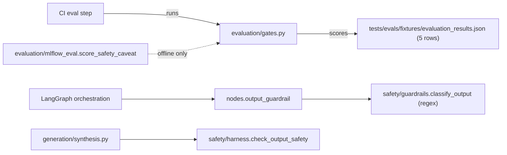
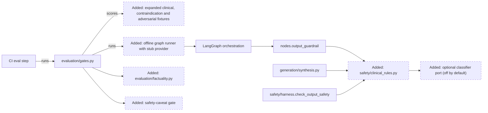
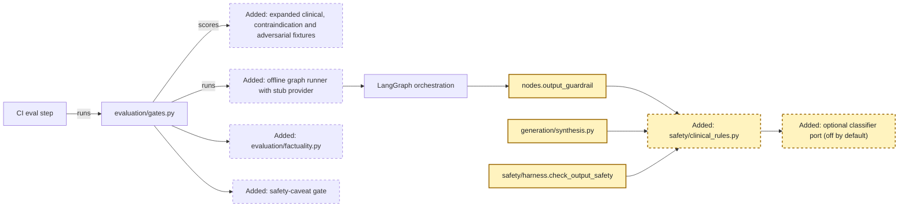
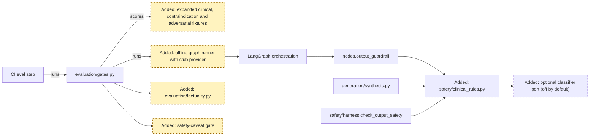
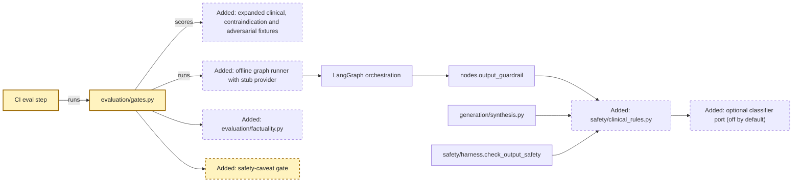

<!-- markdownlint-disable-file -->
# RPI Plan: Healthcare AI P1 - evaluation depth and output safety

## Task Metadata

* Task ID: HC-AI-P1
* Task slug: healthcare-ai-p1-evaluation-safety
* Plan date: 2026-10-23

## Executive Summary

* Bottom line: Make evaluation able to catch clinical-safety regressions (larger fixture set, claim-level factuality and safety-caveat scoring, stricter gates run through the real LangGraph with a stub model), and replace the scattered regex output checks with one shared, deterministic clinical-directive rule engine that all three answer paths use.
* Why this matters: Today the CI gate scores 5 canned rows at a 0.5 minimum, and three separate output-check code paths use different, weak rules. A harmful or ungrounded answer could ship while CI is green.
* Planning result: Complete. Scope is P1 only; P0 is maintained in a separate repo and excluded.
* Confidence and uncertainty: High on integration points (read from code). Medium on threshold values, which must be calibrated on the first real baseline run.

### What You May Not Know

* Three answer paths check output differently: `output_guardrail` in the LangGraph (`classify_output`), `check_output_safety` in the harness, and `synthesis`. `classify_grounding` exists but nothing calls it.
* The harness safety-caveat phrase list ("consult", "synthetic") is duplicated in the MLflow `score_safety_caveat`; a caveat can pass by containing "consult" in any context.
* Production CI gating itself is P0 (out of scope). This plan only makes the gate meaningful; it does not change deploy triggers.
* Deterministic rules are the default decision. A model-based classifier is added only as an optional, off-by-default port (see D1).

## Phase Checklist

### Before



### After



Evaluation gains real inputs (fixtures, a graph runner with a stub provider) and real checks (factuality, safety caveat). Output safety moves from three divergent regex sets to one rule engine that every path calls.

<!-- rpi:phase id=P01 -->
### [x] P01: Shared clinical output-safety rules

Goals:
* Every answer path blocks or caveats the same unsafe clinical directives, so safety no longer depends on which path produced the answer.

Dependencies:
* None



Highlighted work: `OUTG`, `RULES`, `SYNTH`, `HARNESS`, `PORT`.

<!-- rpi:task id=P01-T01 -->
#### [x] P01-T01: Introduce a deterministic clinical-directive rule engine

Goals:
* A single module classifies an answer as pass, caveat-required, or block using rules for stop-medication directives, unsupported dosing instructions, and clinical directives lacking a caveat.

Requirements:
* FR-001, FR-002, NFR-001
* Result type reuses `GuardrailResult` from `agent_core.guardrails` (category, reasons, score).
* Rules are data-driven (patterns plus category) so they can be extended without code changes to callers.
* The engine also includes the harness sensitive-data output rules (SSN, credit card, password) so no existing block is lost; existing `tests/unit/test_harness.py` cases pass unchanged.
* Tests are owned by new `tests/unit/test_clinical_rules.py`; removals: none.

Details:
* New `safety/clinical_rules.py` under the agent-service package. Existing patterns in `classify_output` are migrated here, not duplicated.
* Caveat detection must require a caveat phrase, not a substring such as "consult" appearing anywhere; decide matching in the module and reuse it from the MLflow scorer (P02-T03).
* Cover negation and paraphrase variants in tests (for example "discontinue", "no longer take", "double the dose").

References:
* [domains/healthcare/agent-service/src/healthcare_agent/safety/guardrails.py](../../../domains/healthcare/agent-service/src/healthcare_agent/safety/guardrails.py): current regex rules to migrate
* [domains/healthcare/agent-service/src/healthcare_agent/safety/harness.py](../../../domains/healthcare/agent-service/src/healthcare_agent/safety/harness.py): caveat phrase list
* [.copilot-tracking/research/2026-10-23/healthcare-ai-improvement-priorities-research.md](../../research/2026-10-23/healthcare-ai-improvement-priorities-research.md):
  * Finding 4 (regex output safety) and evidence C10

Dependencies:
* None

<!-- rpi:task id=P01-T02 -->
#### [x] P01-T02: Route every answer path through the shared rules and wire grounding

Goals:
* The LangGraph `output_guardrail`, harness `check_output_safety`, and `synthesis` produce the same verdict for the same answer, and low-grounding answers are caught.

Requirements:
* FR-003, FR-004
* No answer path retains its own private unsafe-output pattern list.
* A caveat-required verdict appends one fixed standard clinical-review caveat on all three paths (block remains block); a cross-path equivalence test asserts identical outcomes for the same answer.
* Blocked answers keep the existing structured outputs (`final_reason`, `guardrails.output_blocked`).

Details:
* Call the shared engine from `nodes.output_guardrail`, `check_output_safety`, and `generation/synthesis.py`; keep their public signatures stable.
* `classify_grounding` is exported but unused; integrate it (or its successor) in the output stage and record the decision when grounding is advisory versus blocking. Existing unit tests in `test_harness.py`, `test_langgraph_agents.py`, and `test_adversarial_inputs.py` must keep passing.

References:
* [domains/healthcare/agent-service/src/healthcare_agent/agents/nodes.py](../../../domains/healthcare/agent-service/src/healthcare_agent/agents/nodes.py): `output_guardrail`
* [domains/healthcare/agent-service/src/healthcare_agent/generation/synthesis.py](../../../domains/healthcare/agent-service/src/healthcare_agent/generation/synthesis.py): harness calls

Dependencies:
* P01-T01

<!-- rpi:task id=P01-T03 -->
#### [x] P01-T03: Add an optional provider-neutral classifier port

Goals:
* Deployments can add a model-based output check without changing callers, and it is disabled unless configured.

Requirements:
* FR-005, NFR-002
* Classifier failure or timeout fails closed to the deterministic verdict being final for blocks and never relaxes a deterministic block.

Details:
* Define a small protocol next to the rules (input: answer and evidence; output: `GuardrailResult`). Default implementation is none. Configuration through `HealthcareAgentSettings`; keep provider specifics out of the port per the governed-AI standards (provider-neutral contracts).
* No model call is made in CI; tests use a fake implementation.

References:
* [domains/healthcare/agent-service/src/healthcare_agent/config/settings.py](../../../domains/healthcare/agent-service/src/healthcare_agent/config/settings.py): settings pattern
* [packages/agent-core/src/agent_core/ports.py](../../../packages/agent-core/src/agent_core/ports.py): existing port conventions

Dependencies:
* P01-T01

<!-- rpi:phase id=P02 -->
### [x] P02: Evaluation fixtures, factuality, and safety scoring

Goals:
* Evaluation measures what matters clinically: whether answers are factually supported by evidence and whether they carry a proper caveat, over a set large enough to notice regressions.

Dependencies:
* P01 (shared caveat matching)



Highlighted work: `FIX`, `RUNNER`, `FACT`, `SAFE`.

<!-- rpi:task id=P02-T01 -->
#### [x] P02-T01: Expand the evaluation fixture set

Goals:
* A versioned fixture set covers medication safety, lab interpretation, coding review, contraindications, and adversarial or unsafe-request cases, each with expected route, required evidence, and expected safety behavior.

Requirements:
* FR-006, NFR-003
* All data is synthetic; no real patient identifiers.
* Case schema (contract):

```json
{"id": "string", "question": "string", "patient_id": "string|null", "expected_request_type": "string", "required_evidence_terms": ["string"], "must_block": false, "must_include_caveat": true}
```

Details:
* Existing fixtures: 12 planner cases and 5 result rows under `tests/evals/fixtures/`, plus the 25-case retrieval benchmark. Extend rather than replace; keep the planner fixture test passing.
* Target at least 60 cases with a minimum per category (stated in NFR-003); calibrate counts to the ontology's seeded drugs, labs, and conditions.

References:
* [domains/healthcare/agent-service/tests/evals/fixtures/planner_route_fixtures.json](../../../domains/healthcare/agent-service/tests/evals/fixtures/planner_route_fixtures.json): existing schema
* [domains/healthcare/knowledge/ontology/entities.yaml](../../../domains/healthcare/knowledge/ontology/entities.yaml): synthetic entities to reference

Dependencies:
* None

<!-- rpi:task id=P02-T02 -->
#### [x] P02-T02: Add a claim-level factuality scorer

Goals:
* Each answer receives a factuality score reflecting how many of its clinical claims (drug, lab, condition, interaction) are supported by the retrieved evidence.

Requirements:
* FR-007, NFR-004
* Deterministic: same inputs give the same score; no network or model call.

Details:
* New `evaluation/factuality.py`: extract claims using ontology vocabularies (drug, lab, and condition names) and compare against vector and graph evidence terms. Report unsupported claims by name for debuggability.
* Document limits: this detects unsupported named entities and relationships, not arbitrary semantic errors; an LLM-judge is out of scope for CI.

References:
* [domains/healthcare/agent-service/src/healthcare_agent/evaluation/mlflow_eval.py](../../../domains/healthcare/agent-service/src/healthcare_agent/evaluation/mlflow_eval.py): scorer conventions
* [domains/healthcare/knowledge/ontology/vocabularies.yaml](../../../domains/healthcare/knowledge/ontology/vocabularies.yaml): term source

Dependencies:
* P02-T01

<!-- rpi:task id=P02-T03 -->
#### [x] P02-T03: Align the safety-caveat scorer with the shared rules and add an offline graph runner

Goals:
* The offline scorer and runtime agree on what a valid caveat is, and evaluation can drive the real LangGraph with a stub provider and in-memory retrieval to produce results without a live stack.

Requirements:
* FR-008, FR-009
* `score_safety_caveat` delegates to the shared caveat matcher from P01-T01.
* Runner needs no network, Neo4j, Qdrant, or LLM.
* Each fixture supplies a scripted `stub_answer` (safe, unsafe, and ungrounded variants) so every gate has a failing case; a negative test shows the gate failing on an unsafe stub answer.
* The stub-based gate validates guardrail and scoring logic, not live model quality; P03-T03 docs and the Executive Summary state this, and a live-LLM eval stays an opt-in follow-up.

Details:
* Reuse test stubs from `tests/unit/test_langgraph_agents.py` patterns for providers and retrieval functions. The runner outputs the same result shape `evaluate_with_gates` already consumes, extended with `factuality` and `safety` entries.

References:
* [domains/healthcare/agent-service/src/healthcare_agent/evaluation/agent_eval.py](../../../domains/healthcare/agent-service/src/healthcare_agent/evaluation/agent_eval.py): existing suite
* [domains/healthcare/agent-service/tests/unit/test_langgraph_agents.py](../../../domains/healthcare/agent-service/tests/unit/test_langgraph_agents.py): stub patterns

Dependencies:
* P01-T01, P02-T01

<!-- rpi:phase id=P03 -->
### [x] P03: Calibrated gates, CI wiring, and docs

Goals:
* The existing CI evaluation step fails when factuality, safety, routing, or evidence regress, using thresholds grounded in a measured baseline.

Dependencies:
* P01, P02



Highlighted work: `CI`, `GATES`, `SAFE`.

<!-- rpi:task id=P03-T01 -->
#### [x] P03-T01: Extend gate thresholds and results model

Goals:
* `gates.py` enforces factuality, safety-caveat, and must-block pass rates in addition to routing, evidence, and answer quality, with raised thresholds.

Requirements:
* FR-010, NFR-005
* Must-block cases are a hard gate: any failure fails the run regardless of averages.
* Thresholds are configurable by CLI flag with defaults recorded in code and docs.

Details:
* Extend `GateThresholds`, `GateResult`, `print_report`, and CLI flags; keep `--results-file` working for existing callers. Run the baseline first, set thresholds just below measured scores with a documented margin, and record the baseline.

References:
* [domains/healthcare/agent-service/src/healthcare_agent/evaluation/gates.py](../../../domains/healthcare/agent-service/src/healthcare_agent/evaluation/gates.py): current gate

Dependencies:
* P02-T02, P02-T03

<!-- rpi:task id=P03-T02 -->
#### [x] P03-T02: Run the offline graph evaluation in the existing CI step

Goals:
* The existing evaluation step in the contracts workflow runs the expanded offline evaluation and the new gates, so regressions fail CI.

Requirements:
* FR-011, NFR-006
* Edit only the evaluation step in `agent-service-contracts.yml`; do not change deploy triggers or `deploy-ai-prd.yml` (P0 is out of scope).
* CI runtime increase stays within NFR-006.

Details:
* Replace the static `--results-file` invocation with the offline runner invocation (a static results file can remain as a unit-test fixture for `evaluate_with_gates`).

References:
* [.github/workflows/agent-service-contracts.yml](../../../.github/workflows/agent-service-contracts.yml): evaluation steps

Dependencies:
* P03-T01

<!-- rpi:task id=P03-T03 -->
#### [x] P03-T03: Update documentation

Goals:
* Readers can see how output safety and evaluation gates now work, and the roadmap reflects delivered items.

Requirements:
* FR-012
* Docs describe the rule engine, optional classifier port, new scorers, thresholds, and known limits of deterministic factuality.

Details:
* Update `docs/06_quality_assurance.md` (gates), `docs/05_ai_agents.md` (guardrails), and `docs/10_healthcare_landscape.md` (factuality and self-reflection status). Run `make validate-docs` for markdownlint.

References:
* [docs/06_quality_assurance.md](../../../docs/06_quality_assurance.md): evaluation gates section
* [docs/10_healthcare_landscape.md](../../../docs/10_healthcare_landscape.md): roadmap table

Dependencies:
* P03-T01

## User Decisions and Requirements

### Confirmed User Direction

* Plan P1 only (evaluation depth and output safety); ignore P0 because it is maintained in a separate repo.
* Source: prioritized research in `healthcare-ai-improvement-priorities-research.md`.

### Planning Decisions and Feedback

| Group | Decision or feedback item | Status | Owner | Rationale or input needed | Evidence | Planning impact |
|-------|---------------------------|--------|-------|---------------------------|----------|-----------------|
| D1 | Output checks: deterministic rule engine as the default, model-based classifier only as an optional port | proposed (agent default) | user | Deterministic is testable in CI and fail-safe; a model check adds latency, cost, and nondeterminism. Reply if you want the classifier enabled by default | Research C10 | P01-T03 scope |
| D2 | Factuality: deterministic entity-support scorer in CI, no LLM judge | proposed (agent default) | user | Keeps CI offline and reproducible; limits detection to named clinical entities | Research C7 | P02-T02, NFR-004 |

## Planning Readiness and Next Step

| Field | Record |
|-------|--------|
| Planning execution and readiness | Complete; Ready for implementation (D1, D2 are non-blocking defaults) |
| Decision participation | user-owned (standalone); D1 and D2 proposed with defaults |
| Blockers | none |
| Latest critique | `.copilot-tracking/reviews/plans/2026-10-23/healthcare-ai-p1-evaluation-safety-plan-critique.md` (see Critique Disposition) |
| Relevant research | [.copilot-tracking/research/2026-10-23/healthcare-ai-improvement-priorities-research.md](../../research/2026-10-23/healthcare-ai-improvement-priorities-research.md) |
| Plan | `.copilot-tracking/plans/2026-10-23/healthcare-ai-p1-evaluation-safety-plan.md` |
| Changes-record role | `.copilot-tracking/changes/2026-10-23/healthcare-ai-p1-evaluation-safety-changes.md` is implementation evidence |
| Continuation owner | user |
| Required gates or confirmations | none |
| Next action | `/rpi-implement` |

## Goals

* Catch clinical-safety regressions in CI through meaningful evaluation.
* Make output safety consistent across every answer path.

## Scope and Non-Goals

### In Scope

* Output-safety rules, optional classifier port, eval fixtures, factuality and safety scorers, gate thresholds, the CI evaluation step, and related docs for the healthcare domain.

### Non-Goals

* P0 items (production Helm flags, deploy gating, authorization default), P2 (PHI redaction, audit store, rate limiting, token identity), P3 roadmap capabilities.
* Supply-chain domain changes.
* LLM-judge evaluation in CI.

## Functional Requirements

* FR-001: A shared rule engine classifies answers as pass, caveat-required, or block.
* FR-002: Rules detect stop-medication directives, unsupported dosing instructions, and clinical directives without a caveat, including paraphrases.
* FR-003: `output_guardrail`, `check_output_safety`, and `synthesis` use the shared engine and agree on verdicts.
* FR-004: Grounding is evaluated in the output stage using the shared checks.
* FR-005: An optional classifier port can augment, never relax, deterministic blocks; disabled by default.
* FR-006: The fixture set has typed cases with expected route, required evidence, block, and caveat expectations.
* FR-007: A claim-level factuality scorer reports score and unsupported claims.
* FR-008: The offline safety-caveat scorer uses the shared caveat matcher.
* FR-009: An offline runner executes the real LangGraph with stubs and emits gate-compatible results.
* FR-010: Gates enforce factuality, safety caveat, and must-block rates.
* FR-011: CI runs the offline evaluation and the new gates.
* FR-012: Documentation reflects the new behavior and limits.

## Non-Functional Requirements

* NFR-001: Rule engine is deterministic and has no network dependency.
  * Objective threshold or evaluation condition: unit tests pass offline with identical outputs across runs.
* NFR-002: Optional classifier cannot weaken safety.
  * Objective threshold or evaluation condition: tests show a classifier error or pass never overrides a deterministic block.
* NFR-003: Fixture coverage.
  * Objective threshold or evaluation condition: at least 60 cases, with at least 8 each for medication safety, lab interpretation, coding review, contraindication, adversarial, and must-block categories.
* NFR-004: Factuality scorer is reproducible and offline.
  * Objective threshold or evaluation condition: identical scores on repeated runs without network access.
* NFR-005: Thresholds are evidence-based.
  * Objective threshold or evaluation condition: baseline scores and margin are recorded; no threshold below the measured baseline minus the stated margin.
* NFR-006: CI cost.
  * Objective threshold or evaluation condition: added evaluation time is at most 3 minutes on the existing runner.

## Risks and Open Questions

| Priority | Type | Risk, question, or planning item | Affected work | Impact | Smallest action or evidence needed | Owner |
|----------|------|----------------------------------|---------------|--------|------------------------------------|-------|
| M | risk | Rule engine false positives block valid answers | P01-T01, P01-T02 | Lower answer availability | Include benign-phrase fixtures; track blocked rate in baseline | planner |
| M | risk | Deterministic factuality misses semantic errors | P02-T02 | False confidence | Document limits (P03-T03); keep P3 self-critique as follow-up | planner |
| M | open question | Baseline scores unknown until the runner exists | P03-T01 | Thresholds may need revision | Run baseline before setting thresholds | downstream |
| L | open question | Tests not executed in this planning session | plan-wide | Unknown current pass state | Run `make test-unit` before starting | downstream |

Test ownership (plan-wide): new `tests/unit/test_clinical_rules.py` (P01), `tests/unit/test_factuality.py` and `tests/evals/test_expanded_eval.py` (P02); existing tests are edited only where signatures change; removals: none; validation commands: `make test-unit`, the gate CLI, and `make validate-docs`.

## Dependencies

* `agent_core.guardrails.GuardrailResult`: shared result type for rules and classifier port.
* Ontology vocabularies: term source for claim extraction.
* Existing test stubs: basis for the offline runner.

## Sources

* [.copilot-tracking/research/2026-10-23/healthcare-ai-improvement-priorities-research.md](../../research/2026-10-23/healthcare-ai-improvement-priorities-research.md): P1 findings 3 and 4 and evidence C6-C10
* [domains/healthcare/agent-service/src/healthcare_agent/evaluation/gates.py](../../../domains/healthcare/agent-service/src/healthcare_agent/evaluation/gates.py): current gate and CLI
* [domains/healthcare/agent-service/src/healthcare_agent/safety/guardrails.py](../../../domains/healthcare/agent-service/src/healthcare_agent/safety/guardrails.py): regex rules and unused `classify_grounding`
* [docs/10_healthcare_landscape.md](../../../docs/10_healthcare_landscape.md): roadmap context
* User request: "provide the plan to P1 and ignore P0".

## Critique Disposition

* Critique setting and provenance: standard; default
* Critique status: complete
* Latest critique and verdict: `.copilot-tracking/reviews/plans/2026-10-23/healthcare-ai-p1-evaluation-safety-plan-critique.md`; Revise (4 Medium), all corrected
* Earlier critiques: none
* Limitations: static read only; no tests executed

| Critique run and finding | Disposition | Action owner | Exact resolving evidence | Decision route | Plan response or residual risk |
|--------------------------|-------------|--------------|--------------------------|----------------|--------------------------------|
| PC-001 Sensitive-data rules could be dropped | accepted, applied | planner | P01-T01 Requirements | direct | Engine includes harness rules; `test_harness.py` unchanged |
| PC-002 Caveat-required undefined | accepted, applied | planner | P01-T02 Requirements | direct | Fixed caveat appended on all paths; equivalence test |
| PC-003 Stub gate measures pipeline | accepted, applied | planner | P02-T03 Requirements | direct | `stub_answer` variants, negative test, limitation documented |
| PC-004 Test ownership not locked | accepted, applied | planner | Risks section test ownership | direct | Owners, no removals, validation commands listed |

## Artifact Self-Check

* [x] Executive Summary, What You May Not Know, and the Phase Checklist come first.
* [x] Direction, decisions, readiness, goals, scope, requirements, risks, and dependencies are consistent.
* [x] Participation recorded; D1 and D2 are agent-proposed defaults, non-blocking.
* [x] Every FR and NFR is cited by a task (NFR-003 by P02-T01, NFR-004 by P02-T02, NFR-005 by P03-T01, NFR-006 by P03-T02).
* [x] Every phase and task has the required blocks.
* [x] Critique ran; see Critique Disposition.
* Checked sections: all.
* Missing or limited sections: Mermaid not rendered in a preview.

## Follow-Up Items

* None

## Handoff

* Authoritative implementation handoff: Planning Readiness and Next Step
